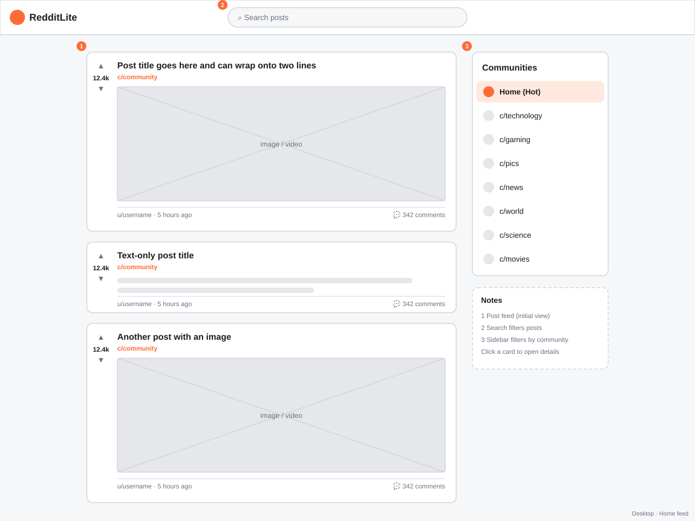
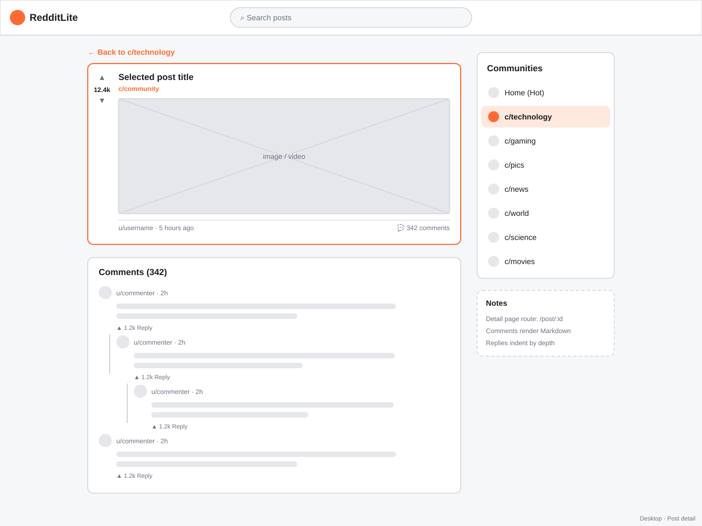
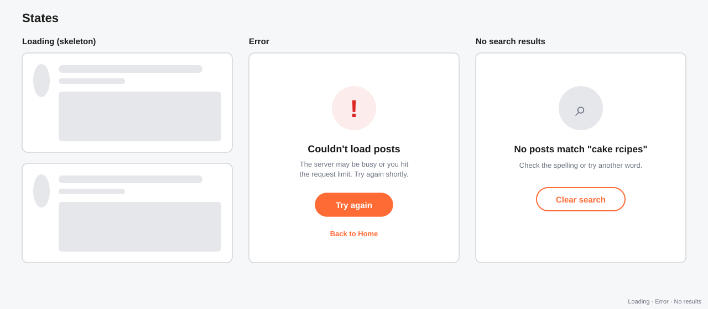
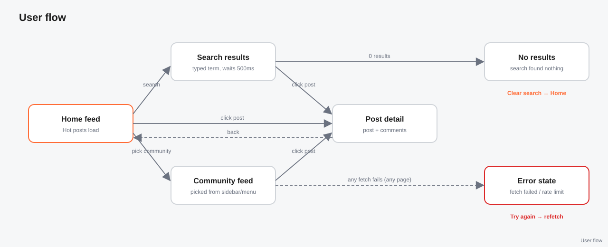

# RedditLite

A Reddit-style reader I built for the Reddit Client portfolio project on Codecademy's Full-Stack Engineer path. It loads hot posts, lets you filter by community and search, and opens any post to show its full comment thread.

**Live site:** https://redditlite-devante.netlify.app

## Why Lemmy instead of Reddit

The project is supposed to use Reddit's free `.json` endpoints, like `reddit.com/r/popular.json`. When I tested that from the browser it came back blocked. Reddit shut off logged-out `.json` access in 2026 and stopped taking new API applications, so there was no way in.

I switched to the [Lemmy](https://join-lemmy.org) API on lemmy.world. Lemmy is an open-source Reddit alternative with the same pieces: communities (`c/technology` instead of `r/technology`), upvotes, Markdown comments, and search. It needs no API key and works straight from the browser.

## What it does

- The home page loads hot posts, with gray loading cards while they come in
- The sidebar filters by community (technology, gaming, pics, news, world, science, movies)
- On phones and tablets the sidebar becomes a menu that slides in from the right
- Search waits until you stop typing, then searches inside the community you're in
- Clicking a post opens its page with nested replies, and Markdown renders as real formatting
- If something fails you get a Try again button, and if saved posts exist they stay on screen with a warning bar
- Every feed and search is saved for 5 minutes, so going back to one costs no new request

## Wireframes

I planned the layout before building. All of them are in [`docs/wireframes`](docs/wireframes).






## Built with

- React 19 and Vite
- Redux Toolkit for posts, search, and comments, with `createAsyncThunk` for the requests
- React Router for the feed and post pages
- react-markdown for comments and post text
- Vitest and React Testing Library for unit tests
- Playwright for end-to-end tests
- Netlify for hosting, GitHub Projects for planning

The project brief says to use Enzyme, but Enzyme was never updated past React 17, so I used React Testing Library, which is what replaced it.

## Running it

```
npm install
npm run dev
```

Then open the address Vite prints (usually http://localhost:5173).

### Tests

```
npm run test:run
```

```
 Test Files  7 passed (7)
      Tests  30 passed (30)
```

The end-to-end tests run every flow on a desktop screen and a Pixel 7 phone screen:

```
npx playwright install chromium
npm run test:e2e
```

```
  1 skipped
  17 passed (19.0s)
```

The skipped one is the mobile menu test on desktop, since that menu only exists on small screens. Both test suites answer the API with local fake data, so they never depend on lemmy.world being up.

## What I learned

The rate limit shaped most of the Redux code. I cache every result by community and search term, and the thunk's `condition` option cancels a request before it starts if a fresh copy is saved. In dev mode React runs effects twice, which was sending two requests for the same feed, so I added a check that skips a feed that's already loading.

Search taught me debouncing. Each keystroke cancels the last timer and starts a new one, so typing "keyboard" sends one request instead of eight.

Lemmy sends comments as one flat list, and each comment has a `path` like `0.10.11` that says who it replies to. I wrote a function that splits the path to find each comment's parent and builds the tree, then a `Comment` component that renders itself for the replies.

A couple of bugs I tracked down:
- My images were stuck invisible. They fade in on `onLoad`, but images already in the browser cache finished loading before React was listening, so the event never fired. I added a check for `img.complete` when the image mounts.
- Memes had their top text cut off because I used `object-fit: cover`. Switching to `contain` shows the whole image.
- The page went white after I installed a package while the dev server was running. Vite's dependency cache got out of sync, and restarting with `npm run dev -- --force` fixed it.

For Lighthouse, I split the post page and the Markdown library into their own files with `React.lazy`, so the main file went from 414 KB to 296 KB. I also darkened the orange I use for text because the bright one failed the contrast check. Scores are 96 to 100 in every category on mobile and desktop.

## Future work

- Infinite scroll instead of one page of 20 posts
- Logging in so you can vote and comment
- A dark mode
- Picking which Lemmy server to read from
- Sorting by Top, New, and Active
- Making it installable as a progressive web app

Built by DeVante Bush
